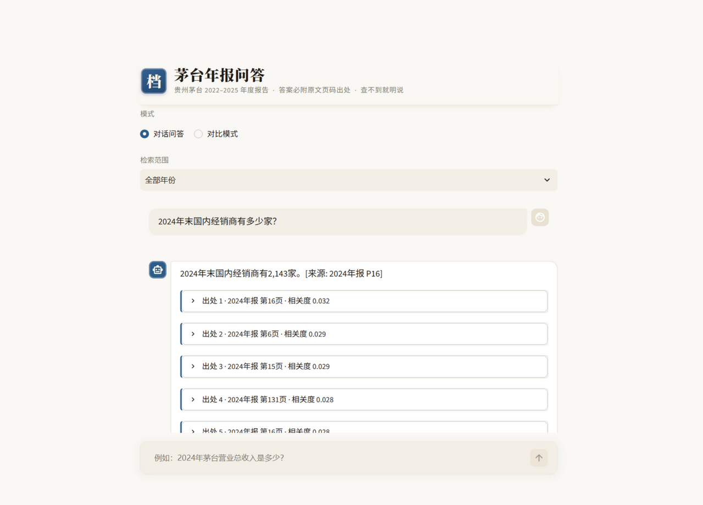
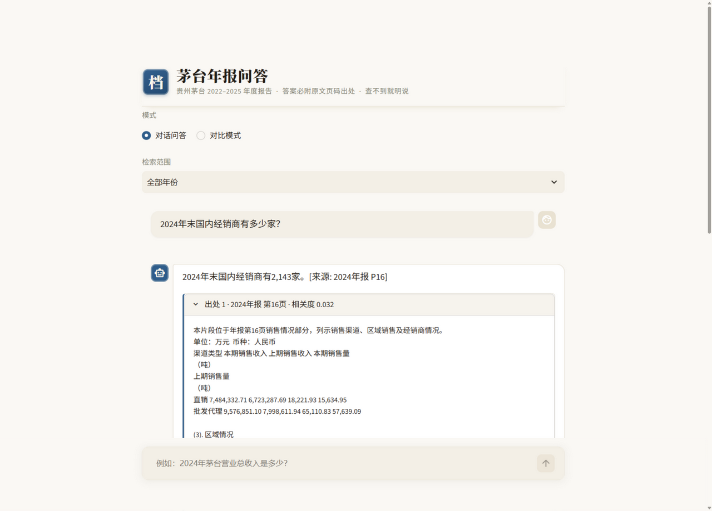
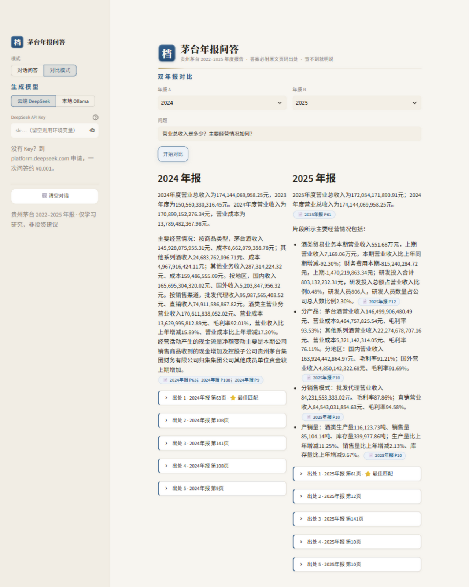
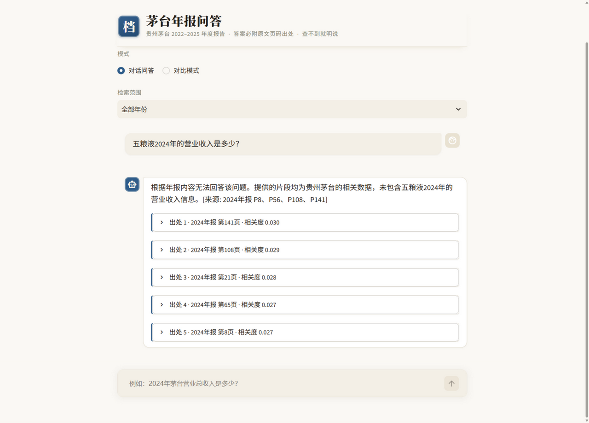
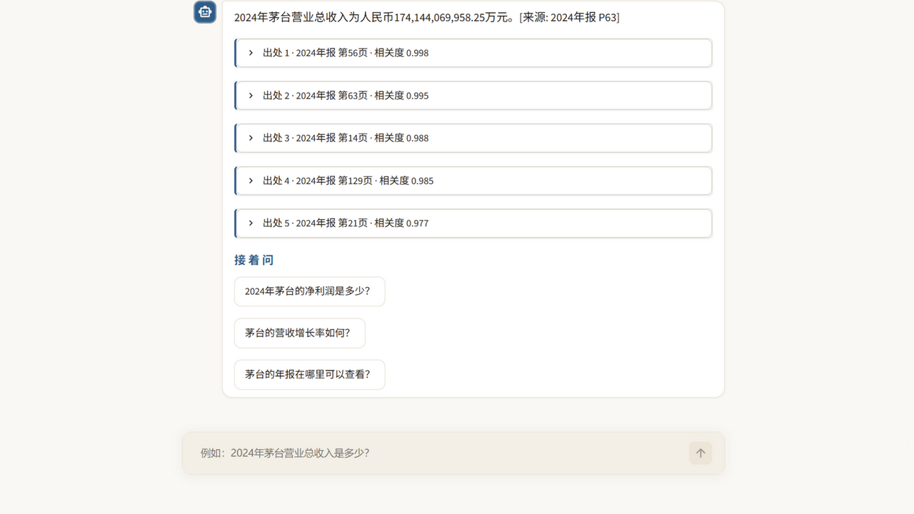
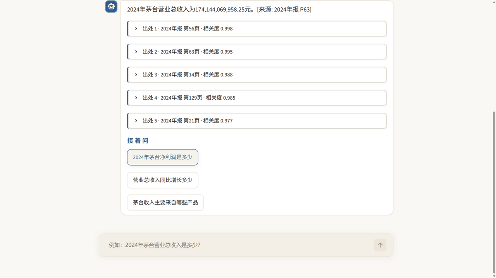
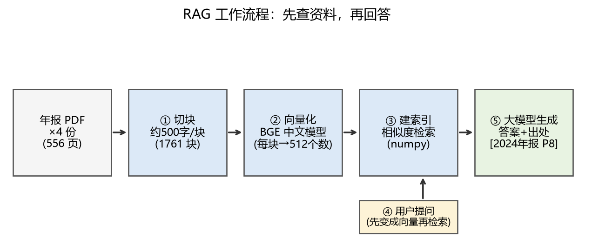
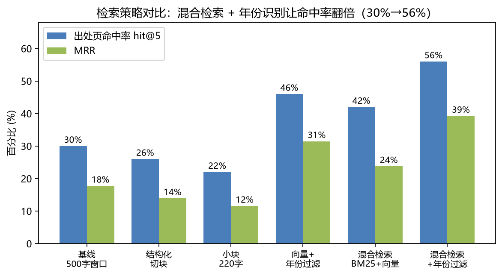
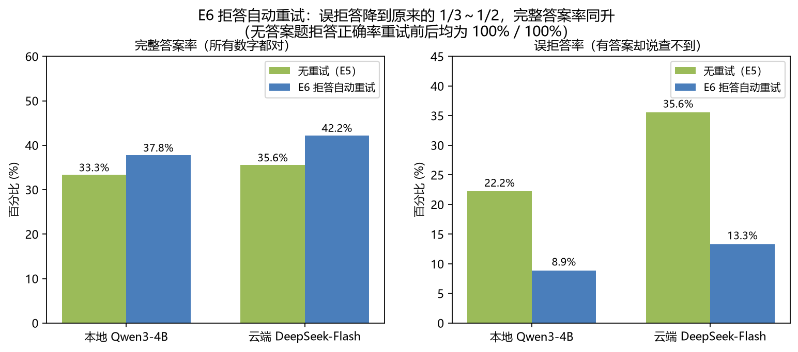

<div align="center">

# 茅台财报 RAG 问答系统

**把贵州茅台 2022–2025 年 4 份年报（556 页）变成一个"能提问的资料库"**

自然语言提问 · 答案必附原文页码出处 · 查不到就明说
全流程可本地运行，检索与嵌入 CPU 即可

[](LICENSE)




*问一句，答一句，出处跟着答案走*

</div>

---

## 目录

- [这是什么](#这是什么)
- [功能一览](#功能一览)
- [系统架构](#系统架构)
- [快速开始](#快速开始)
- [效果如何：50 题黄金集可评测](#效果如何50-题黄金集可评测)
- [仓库结构](#仓库结构)
- [技术报告](#技术报告)
- [边界与免责声明](#边界与免责声明)

---

## 这是什么

给投资者、研究者、也给自己用：**上市公司年报动辄五六百页，想找一个数
要翻半天目录**。本项目把 4 份茅台年报整体读进一个可检索的资料库，你用
一句话提问，它负责翻页找数，并把**原文页码**放在答案旁边让你随时核对。

三个设计底线：

1. **每个答案必须带出处**——大模型直接答财报容易"编"，这里强制它先查
   资料再回答，答案旁挂出所引用的页码和原文片段；
2. **查不到就明说**——年报里根本没有的信息，系统明确拒答（评测中
   无答案题拒答正确率 100%，一次都没有编造）；
3. **全部可以本地跑**——嵌入、检索、生成三环节都能离线运行，不依赖
   任何云服务（接云端大模型是可选项）。

## 功能一览

### 💬 对话问答，出处跟着答案走

直接用自然语言提问；每条答案下方自动挂出**出处档案卡**（年份、页码、
相关度），点开即可看到所引用的原文片段，十秒内完成核对。

<div align="center">

</div>

回答之后系统还会推荐 3 个**接着问**的问题（追问），点击即问，不用想
下一句怎么措辞。另外，问题里直接写"P6"或"第6页"会触发**页码直达**：
跳过语义检索，取该页原文回答。

### ⚖️ 双年报对比模式

同一问题在两份年报里并排回答，看变化不用来回切换文件：

<div align="center">

</div>

### 🔒 查不到就明说

问年报里没有的事，系统不编造、不硬答，明确告知查不到并列出检索依据：

<div align="center">

</div>

### 🖥️ 本地 / 云端，一键切换

同一套检索管线，生成模型可选本机 Ollama（Qwen3-4B，离线、零成本）或
云端 DeepSeek（更准）。切换只需改环境变量，界面完全一致：

| 本地 Qwen3-4B | 云端 DeepSeek-Flash |
|---|---|
|  |  |

## 系统架构

<div align="center">


*先查资料，再回答：离线建库做一次，在线问答每次提问*

</div>

## 快速开始

```bash
# 0. 环境：Windows / Python 3.12（检索与嵌入 CPU 即可，显卡仅加速本地生成）
python -m venv .venv && .venv\Scripts\activate
pip install -r requirements.txt

# 1. 下载 4 份年报（巨潮资讯网公开文件，约 30MB）
python scripts/download_data.py

# 2. 提取文本 + 建索引
python scripts/extract_text.py
python scripts/build_index.py

# 3. 语境增强索引（可选，推荐：检索 62%→66%，需 DEEPSEEK_API_KEY，约 3 元）
#    set DEEPSEEK_API_KEY=你的key
python scripts/build_contextual_chunks.py

# 4. 本地生成模型（可选，用于完整问答）
#    安装 Ollama 后导入 Qwen3-4B（见 ollama.Modelfile）

# 5. 启动问答界面
python -m streamlit run src/app.py

# 6. 复现评测
python scripts/evaluate_retrieval.py      # 检索层
python scripts/evaluate_answers.py --name final_local   # 答案层（本地模型）
# 云端对比（可选）：
#   set RAG_BASE_URL=https://api.deepseek.com/v1
#   set RAG_MODEL=deepseek-flash
#   set RAG_API_KEY=你的key
#   python scripts/evaluate_answers.py --name final_cloud
```

## 效果如何：50 题黄金集可评测

自建 50 题评测集（30 事实题 / 10 跨页题 / 5 跨年对比 / 5 无答案题），
检索是否命中出处页由程序判定，全部数字可复现（脚本在 `scripts/`，
原始结果在 `results/`）。每一步改进都有对照实验：

### 检索层：出处页命中率 hit@5 从 30% 提升到 66%

| 实验 | 改动 | hit@5 | 增益 |
|---|---|---|---|
| 基线 | 500字窗口切块 + 纯向量检索 | 30% | — |
| E1 | 更小块/结构化切块 | 22~26% | ❌ 更细反而更差 |
| E2 | 混合检索（BM25+向量 RRF）+ 年份识别过滤 | 56% | 年份正则 +16pp，性价比最高 |
| E3 | bge-reranker 精排 | 62% | +6pp，代价约 2 秒/次 |
| E5 | 语境增强索引：大模型给每块写"说明书" | **66%** | +4pp，取代精排，建库约 3 元 |
| E7 | 表格感知解析：pdfplumber 键值句线性化 | 58% | ❌ 不敌语境句（详见报告） |

<div align="center">

</div>

### 答案层：拒答自动重试 + 数字接地校验

| 配置 | 完整答案率 | 误拒答率 | 无答案题拒答正确率 |
|---|---|---|---|
| 本地 Qwen3-4B | 33.3% → **37.8%** | 22.2% → **8.9%** | 100% |
| 云端 DeepSeek-Flash | 35.6% → **42.2%** | 35.6% → **13.3%** | 100% |

<div align="center">

</div>

两个值得一看的发现：**误拒答**（明明查到了却说"无法回答"）是大模型在
财报问答里的头号失分，一次"扩充检索再问一遍"的重试就能砍掉三分之二；
而对答错题目的归因显示，**六成错题的答案其实已经在检索资料里**——瓶颈
在模型抄写而非检索，数字接地校验因此被用来定位可疑数字。

## 仓库结构

```
src/          核心代码：切块/索引/混合检索/语境增强/问答/Streamlit 界面
scripts/      下载、建索引、评测、画图等一次性脚本
data/gold/    50 题黄金评测集（问题+标准答案+出处页码）
results/      全部评测结果 JSON（每个数字都出自这里）
report/       通俗中文技术报告（LaTeX 源码 + 图表）
docs/         界面截图
```

## 技术报告

完整的项目报告（含实验设计、badcase 逐例分析、经验教训）见
`report/report.tex`，用 [tectonic](https://tectonic-typesetting.github.io/) 编译：

```bash
tectonic -o report/_build report/report.tex
```

## 边界与免责声明

<details>
<summary>点击展开</summary>

本项目数据来自[巨潮资讯网](http://www.cninfo.com.cn)依法公开披露的上市公司
年度报告，**仅用于学习和技术研究，不构成任何投资建议**。本项目与贵州茅台酒
股份有限公司无任何关联；相关商标归其权利人所有。请勿将本仓库中的语料处理
方式用于未经授权的商业场景。

</details>

## License

[MIT](LICENSE)
