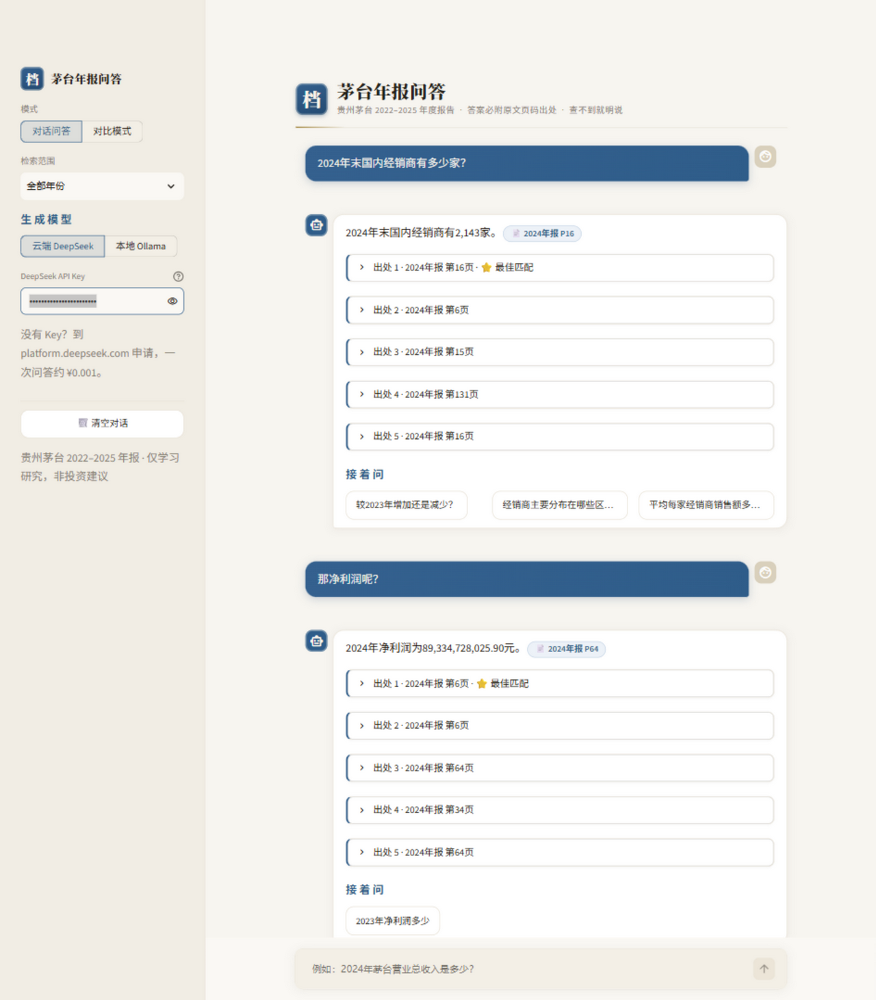
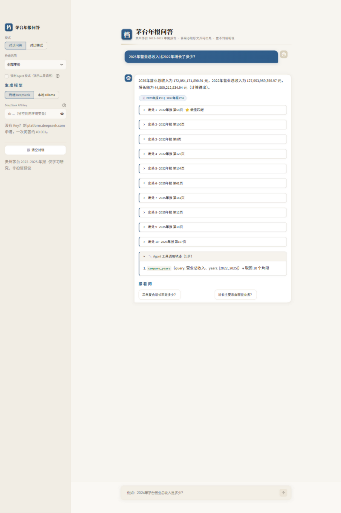
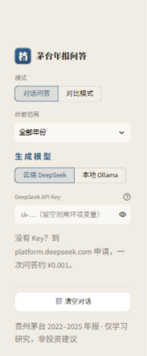

<div align="center">

# 茅台财报 RAG 问答系统

**把贵州茅台 2022–2025 年 4 份年报（556 页）变成一个"能提问的资料库"**

自然语言提问 · 答案必附原文页码出处 · 查不到就明说
全流程可本地运行，检索与嵌入 CPU 即可

[](LICENSE)


*问一句，答一句，出处跟着答案走*

</div>

---

## 目录

- [这是什么](#这是什么)
- [功能一览](#功能一览)
- [系统架构](#系统架构)
- [快速开始：Docker / 源码 / API](#快速开始)
- [效果如何：50 题黄金集可评测](#效果如何50-题黄金集可评测)
- [仓库结构](#仓库结构)
- [技术报告](#技术报告)
- [边界与免责声明](#边界与免责声明)

---

## 这是什么

给投资者、研究者、也给自己用：**上市公司年报动辄五六百页，想找一个数
要翻半天目录**。本项目把 4 份茅台年报整体读进一个可检索的资料库，你用
一句话提问，它负责翻页找数，并把**原文页码**放在答案旁边让你随时核对。

三个设计底线：

1. **每个答案必须带出处**——大模型直接答财报容易"编"，这里强制它先查
   资料再回答，答案旁挂出所引用的页码和原文片段；
2. **查不到就明说**——年报里根本没有的信息，系统明确拒答（评测中
   无答案题拒答正确率 100%，一次都没有编造）；
3. **全部可以本地跑**——嵌入、检索、生成三环节都能离线运行，不依赖
   任何云服务（接云端大模型是可选项）。

## 功能一览

### 💬 对话问答，出处跟着答案走

直接用自然语言提问；每条答案下方自动挂出**出处档案卡**（年份、页码），
点开即可看到所引用的原文片段，十秒内完成核对。

<div align="center">

</div>

回答之后系统还会推荐 3 个**接着问**的问题（追问），点击即问，不用想
下一句怎么措辞。另外，问题里直接写"P6"或"第6页"会触发**页码直达**：
跳过语义检索，取该页原文回答。

### 🧠 追问有记忆

问过"2024年末国内经销商有多少家？"之后，直接追问**"那净利润呢？"**——
系统自动把追问补全成"2024年净利润是多少？"，继承上一问的年份与主体，
不用每次都问完整句子：

<div align="center">

</div>

### 🤖 复杂题自动进 Agent 模式（Function Calling）

跨年对比、多指标组合这类复杂题，一次检索装不下所有证据。系统按问题特征
自动路由到 **Function Calling 工具循环**：大模型自己决定调哪个工具——
`search_reports` 按年检索、`page_direct` 整页直读、`compare_years` 跨年
分别取证——分多轮取齐证据后再作答；简单题仍走原有直通管线，不白花
延迟与费用。答案下方的**工具调用轨迹**可展开，Agent 每一步调了什么
工具、取回多少片段完全透明：

<div align="center">

</div>

### 🔑 自带 Key 即用，也能完全离线

侧边栏一键切换生成模型：粘贴你自己的 **DeepSeek API Key**（只保存在
当前浏览器会话，不上传任何第三方）即刻云端问答，无需任何本地模型；
选**本地 Ollama**（Qwen3-4B）则完全离线、零成本：

<div align="center">

</div>

### ⚖️ 双年报对比模式

同一问题在两份年报里并排回答，看变化不用来回切换文件：

<div align="center">

</div>

### 🔒 查不到就明说

问年报里没有的事，系统不编造、不硬答，明确告知查不到并列出检索依据：

<div align="center">

</div>

## 系统架构

<div align="center">


*先查资料，再回答：离线建库做一次，在线问答每次提问*

</div>

## 快速开始

### 方式一：Docker 一键起（网页 + API）

```bash
docker compose up --build
```

- 网页界面：http://localhost:8501 （首次启动自动下载年报并建索引，约 3-5 分钟）
- API 文档：http://localhost:8000/docs
- （可选）云端生成：在项目根目录建 `.env` 写入 `DEEPSEEK_API_KEY=sk-…`，
  或启动后直接在网页**侧边栏粘贴自己的 Key**。不配 Key 也可配合
  本地 Ollama 使用（需自行安装并映射模型目录进容器）。

### 方式二：源码运行

```bash
# 0. 环境：Windows / Linux / Python 3.12（检索与嵌入 CPU 即可）
python -m venv .venv && .venv\Scripts\activate
pip install -r requirements.txt

# 注：语境增强索引已随仓库分发（data/chunks/contextual.jsonl +
#     data/index/contextual.npz，共 5.5MB）——克隆后即可直接问答与复现
#     评测；想从头重建再执行下面第 1-2 步（需下载约 30MB 年报 PDF）

# 1. 下载 4 份年报（巨潮资讯网公开文件，约 30MB）
python scripts/download_data.py

# 2. 提取文本 + 建索引
python scripts/extract_text.py
python scripts/build_index.py

# 3. 启动问答界面（侧边栏粘贴 DeepSeek Key 即云端问答；
#    或选本地 Ollama qwen3:4b 完全离线）
python -m streamlit run src/app.py

# 4. 语境增强索引（可选，推荐：检索 62%→66%，需 DeepSeek Key，约 3 元）
python scripts/build_contextual_chunks.py

# 5. 复现评测
python scripts/ci_retrieval_gate.py                    # 检索层·生产管线（应显示 hit@5 66%，低于 64% 报错）
python scripts/evaluate_retrieval.py                   # 检索层·E1 基线对照（历史实验口径 30%）
python scripts/evaluate_answers.py --name final_local  # 答案层（本地模型）
```

### 也可以做成 API 服务

```bash
uvicorn src.api:app --port 8000     # Swagger 交互文档: /docs
```

```bash
# 单轮问答
curl -X POST localhost:8000/ask -H "Content-Type: application/json" \
  -d '{"question": "2024年末国内经销商有多少家？"}'

# 多轮追问：回传 history，"那净利润呢？"自动补全为"2024年净利润是多少？"
curl -X POST localhost:8000/ask -H "Content-Type: application/json" \
  -d '{"question": "那净利润呢？", "history": [{"role": "user", "content": "2024年末国内经销商有多少家？"}, {"role": "assistant", "content": "2024年末国内经销商有2,143家。"}]}'
```

返回 `answer`（含出处标注）、`sources`（页码级出处数组）、`refused`
（是否拒答）与 `standalone_question`（多轮改写结果）；请求带 `"api_key"`
字段即可用你自己的 DeepSeek Key。

### 也可以做成 MCP 工具，接进 Claude Desktop / Cursor

本项目还是一个 **MCP（Model Context Protocol）server**：任何 MCP 客户端
都能把"茅台年报问答"当成一个标准工具直接调用，配置即插即用：

```json
{
  "mcpServers": {
    "maotai-annual-report": {
      "command": "<项目路径>/.venv/Scripts/python.exe",
      "args": ["<项目路径>/src/mcp_server.py"]
    }
  }
}
```

本地一行即可实测（起 stdio 子进程 → 握手 → 列工具 → 真实调用一次）：

```bash
.venv/Scripts/python.exe scripts/test_mcp_client.py "2025年比2022年净利润增长了多少？"
```

真实调用记录见 `results/mcp_test_answer.txt`：跨年对比题返回带两个年份
页码出处的计算结果。server 启动时预热检索模型（数秒，之后进程内复用），
并从项目 `.env` 兜底读取 DeepSeek Key（MCP 客户端拉起子进程时默认过滤
密钥类环境变量，值不打印、不入日志）。

## 效果如何：50 题黄金集可评测

自建 50 题评测集（30 事实题 / 10 跨页题 / 5 跨年对比 / 5 无答案题），
检索是否命中出处页由程序判定，全部数字可复现（脚本在 `scripts/`，
原始结果在 `results/`）。每一步改进都有对照实验；**每次推送 GitHub
都会自动免费复跑检索层评测**（`eval-gate` 工作流，hit@5 低于 64% 直接
失败亮红灯），防止改动悄悄打漏水位：

### 检索层：出处页命中率 hit@5 从 30% 提升到 66%

| 实验 | 改动 | hit@5 | 增益 |
|---|---|---|---|
| 基线 | 500字窗口切块 + 纯向量检索 | 30% | — |
| E1 | 更小块/结构化切块 | 22~26% | ❌ 更细反而更差 |
| E2 | 混合检索（BM25+向量 RRF）+ 年份识别过滤 | 56% | 年份正则 +16pp，性价比最高 |
| E3 | bge-reranker 精排 | 62% | +6pp，代价约 2 秒/次 |
| E5 | 语境增强索引：大模型给每块写"说明书" | **66%** | +4pp，取代精排，建库约 3 元 |
| E7 | 表格感知解析：pdfplumber 键值句线性化 | 58% | ❌ 不敌语境句（详见报告） |

<div align="center">

</div>

### 答案层：拒答自动重试 + 数字接地校验

| 配置 | 完整答案率 | 误拒答率 | 无答案题拒答正确率 |
|---|---|---|---|
| 本地 Qwen3-4B | 33.3% → **37.8%** | 22.2% → **8.9%** | 100% |
| 云端 DeepSeek-Flash | 35.6% → **42.2%** | 35.6% → **13.3%** | 100% |

<div align="center">

</div>

两个值得一看的发现：**误拒答**（明明查到了却说"无法回答"）是大模型在
财报问答里的头号失分，一次"扩充检索再问一遍"的重试就能砍掉三分之二；
而对答错题目的归因显示，**六成错题的答案其实已经在检索资料里**——瓶颈
在模型抄写而非检索，数字接地校验因此被用来定位可疑数字。

### 答案层 2.0：复杂题路由到 Agent 工具循环

一次检索的 top-5 装不下"两个年份""两个指标"的全部证据——这正是跨年题
（40%）与跨页多指标题（20%）失分的根因。把这类题路由到 Function Calling
工具循环、分轮取齐证据后再答，同一套 50 题复测（云端 DeepSeek-Flash）：

| 题型 | 直通管线 | Agentic 路由 | 增益 |
|---|---|---|---|
| 跨年对比（5 题） | 40% | **80%** | +40pp |
| 跨页多指标（10 题） | 20% | **50%** | +30pp |
| 事实题（30 题） | 50% | 56.7% | +6.7pp |
| **整体完整答案率（45 有答案题）** | 42.2% | **57.8%** | **+15.6pp** |
| 无答案题拒答正确率 | 100% | 100% | 持平 |

直通题行为一行未改（`answer_question` 向后兼容），检索层 hit@5 66% 零回退；
路由是零成本正则（≥2 个年份 / 对比词 / 多问号 / "分别是"句式），50 题里
23 题进 agent、27 题保持直通。结果文件：`results/agentic_cloud_answers.json`。

**这个提升是统计显著的，不是运气**：45 题配对样本中 7 次不一致全部是
新管线获胜（0 次反例），McNemar 精确检验 **p=0.016**；提升量 +15.6pp 的
bootstrap 95% 置信区间 **[+6.7pp, +26.7pp]**，不含 0。复现命令：

```bash
python scripts/stat_significance.py \
  --baseline results/final_e8_cloud_answers.json \
  --treatment results/agentic_cloud_answers.json
```

### 生成质量：忠实度评测（LLM-as-judge）

数字比对能判"标准答案里的数有没有出现"，判不了"答案里的每个论断是否
真有原文依据"。参考 RAGAS 的 faithfulness 口径，用 DeepSeek-Flash 当
判卷员，对照**作答时实际看到的检索原文**给每份答案打忠实度与相关性分
（1-5 分）并摘录无依据论点（脚本 `scripts/evaluate_faithfulness.py`）：

- 41 份非拒答答案：**忠实度均分 5.0 / 相关性均分 5.0，无依据论点 0 条**
- 判卷员经过对抗校验：喂编造数字的答案判 3 分并精确摘录该论点，喂
  只答一半的答案相关性判 3 分——不是盖橡皮章
- 全 5.0 与 E8 的归因互相印证：数字接地校验在源头修掉了"抄错数"，
  剩余失分是检索未送达与评测匹配口径，而非编造

结果文件：`results/agentic_cloud_faithfulness.json`。

## 仓库结构

```
src/          核心代码：切块/索引/混合检索/语境增强/问答（直通+Agent 路由）/
              Streamlit 界面/FastAPI 服务/MCP server
scripts/      下载、建索引、评测（答案层/忠实度）、画图等一次性脚本
docker/       容器入口脚本（Dockerfile 与 docker-compose.yml 在根目录）
data/gold/    50 题黄金评测集（问题+标准答案+出处页码）
results/      全部评测结果 JSON（每个数字都出自这里）
report/       通俗中文技术报告（LaTeX 源码 + 图表）
docs/         界面截图
```

## 技术报告

完整的项目报告（含实验设计、badcase 逐例分析、经验教训）见
`report/report.tex`，用 [tectonic](https://tectonic-typesetting.github.io/) 编译：

```bash
tectonic -o report/_build report/report.tex
```

## 边界与免责声明

<details>
<summary>点击展开</summary>

本项目数据来自[巨潮资讯网](http://www.cninfo.com.cn)依法公开披露的上市公司
年度报告，**仅用于学习和技术研究，不构成任何投资建议**。本项目与贵州茅台酒
股份有限公司无任何关联；相关商标归其权利人所有。请勿将本仓库中的语料处理
方式用于未经授权的商业场景。

</details>

## License

[MIT](LICENSE)
