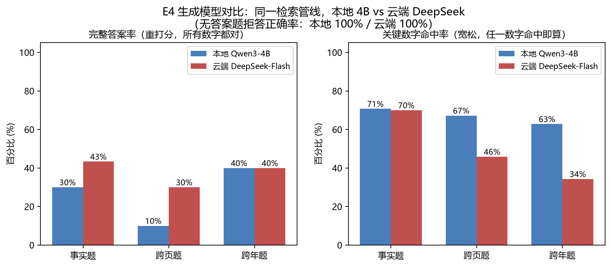

# 茅台年报问答系统 · 可评测的财报 RAG

> 把贵州茅台 2022–2025 年 4 份年报（556 页）做成一个"能提问的资料库"：
> 自然语言提问，答案必附**原文页码出处**，查不到就明说。
> 全流程可本地运行，效果由 50 题黄金评测集量化验证。


## 效果一览（50 题黄金评测集，全部数字可复现）

**检索层**：出处页命中率 hit@5 从 30% 提升到 62%，每一步都有对照实验：

| 实验 | 改动 | hit@5 | 增益 |
|---|---|---|---|
| 基线 | 500字窗口切块 + 纯向量检索 | 30% | — |
| E1 | 更小块/结构化切块 | 22~26% | ❌ 更细反而更差（页级出处目标下是覆盖面问题） |
| E2 | 混合检索（BM25+向量 RRF）+ 年份识别过滤 | 56% | 年份正则 +16pp，全项目性价比最高 |
| E3 | bge-reranker 精排（top20→top5） | **62%** | +6pp，代价是每次查询约 2 秒 CPU 推理 |

**答案层**（同一检索管线，只换生成模型）：

| 模型 | 完整答案率 | 关键数字命中率 | 误拒答率 | 无答案题拒答正确率 |
|---|---|---|---|---|
| 本地 Qwen3-4B（Ollama） | 26.7% | 68.6% | 15.6% | 100% |
| 云端 DeepSeek-Flash（实测花费 0.53 元） | 40.0% | 58.5% | 33.3% | 100% |
| 云端 · 只看实际回答的题 | **60.0%** | **85.1%** | — | — |



**最有趣的发现——质量与覆盖的权衡**：
小模型"敢答但常错"（数字单位都能抄错），大模型"答得准但惜答"（误拒答率翻倍，
放弃了本可答对的题）。换更强的模型买到的是**质量**，不是**覆盖**。
安全底线两边都没破：年报里根本没有答案的 5 道题，系统**一次都没有编造**。

**其他特性**：

- 📄 **页码直达**：问题里写"P6"或"第6页"会跳过语义检索，直接取该页原文回答
- 💬 **追问推荐**：每次回答后自动生成 3 个可继续问的问题，点击即问
- ⚖️ **对比模式**：同一问题在两份年报内并排回答
- 🧪 **确定性评测**：检索是否命中出处页由程序判定，不依赖大模型打分，零成本可复现
- 🔒 **全本地运行**：嵌入/检索/生成均可离线（云端对比为可选项）

## 本地 vs 云端（同一问题，同一出处，只差模型）

| 本地 Qwen3-4B | 云端 DeepSeek-Flash |
|---|---|
|  |  |

注意本地答案把单位抄成了"万元"（相差一万倍），云端正确——这就是 26.7% 完整
答案率背后的真实失败模式。

## 快速开始

```bash
# 0. 环境：Windows / Python 3.12（检索与嵌入 CPU 即可，显卡仅加速本地生成）
python -m venv .venv && .venv\Scripts\activate
pip install -r requirements.txt

# 1. 下载 4 份年报（巨潮资讯网公开文件，约 30MB）
python scripts/download_data.py

# 2. 提取文本 + 建索引
python scripts/extract_text.py
python scripts/build_index.py

# 3. 本地生成模型（可选，用于完整问答）
#    安装 Ollama 后导入 Qwen3-4B（见 ollama.Modelfile）

# 4. 启动问答界面
python -m streamlit run src/app.py

# 5. 复现评测
python scripts/evaluate_retrieval.py      # 检索层
python scripts/evaluate_answers.py --name final_local   # 答案层（本地模型）
# 云端对比（可选）：
#   set RAG_BASE_URL=https://api.deepseek.com/v1
#   set RAG_MODEL=deepseek-flash
#   set RAG_API_KEY=你的key
#   python scripts/evaluate_answers.py --name final_cloud
```

## 仓库结构

```
src/          核心代码：切块/索引/混合检索/精排/问答/Streamlit 界面
scripts/      下载、建索引、评测、画图等一次性脚本
data/gold/    50 题黄金评测集（问题+标准答案+出处页码）
results/      全部评测结果 JSON（论文里的每个数字都出自这里）
report/       通俗中文技术报告（LaTeX 源码 + 图表）
docs/         界面截图
```

## 技术报告

完整的项目报告（含实验设计、badcase 逐例分析、经验教训）见
`report/report.tex`，用 [tectonic](https://tectonic-typesetting.github.io/) 编译：

```bash
tectonic -o report/_build report/report.tex
```

## 免责声明

本项目数据来自[巨潮资讯网](http://www.cninfo.com.cn)依法公开披露的上市公司
年度报告，**仅用于学习和技术研究，不构成任何投资建议**。本项目与贵州茅台酒
股份有限公司无任何关联；相关商标归其权利人所有。请勿将本仓库中的语料处理
方式用于未经授权的商业场景。

## License

[MIT](LICENSE)
